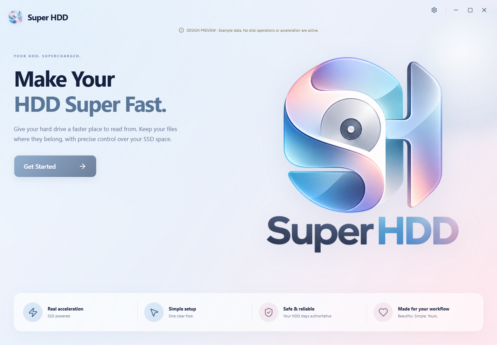
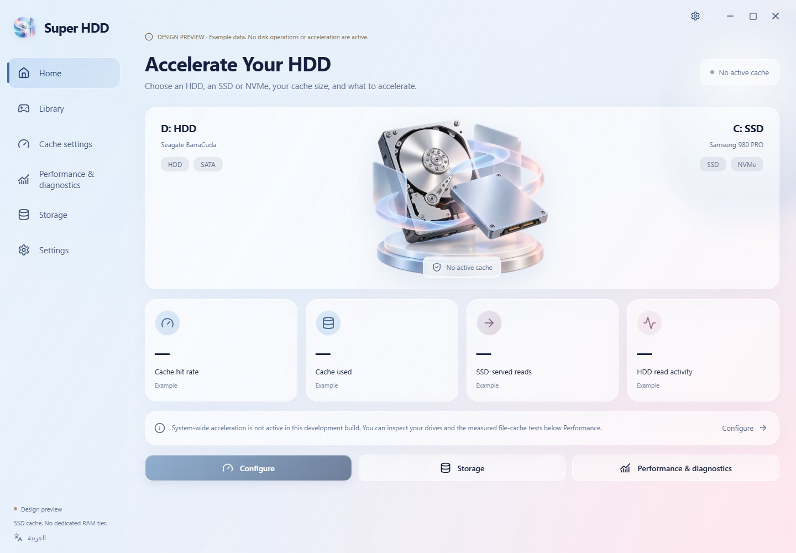
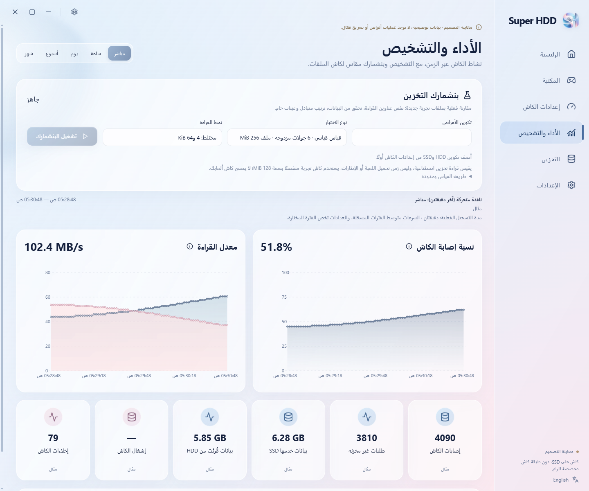
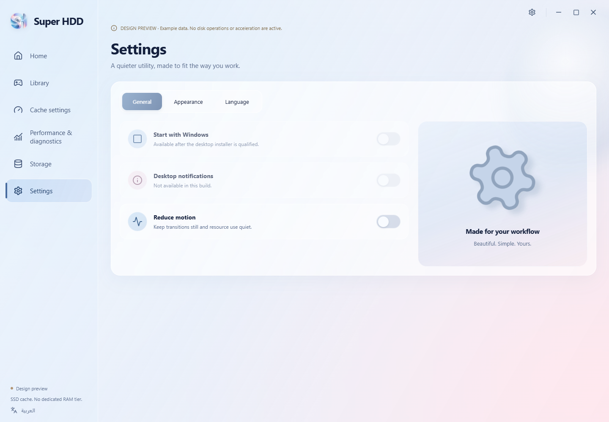
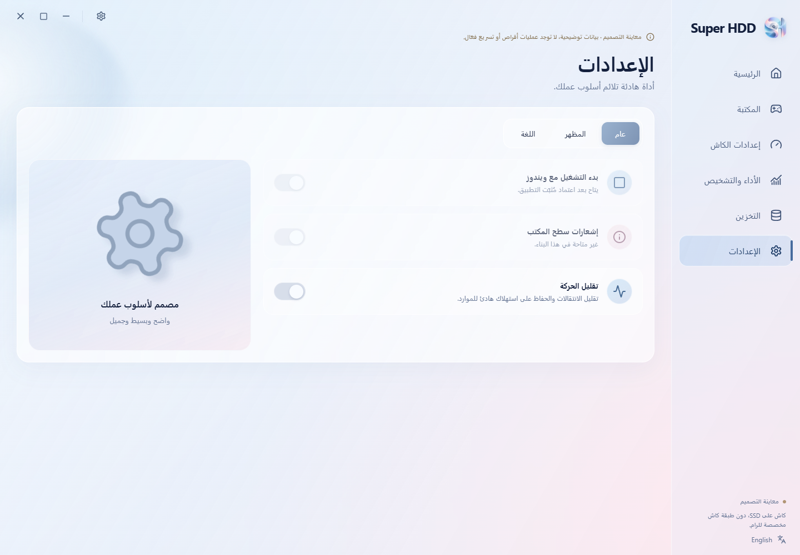

# SuperHDD

Open-source Windows desktop application that uses SSD space to cache selected
game and application folders stored on an HDD.

Built with **Tauri 2, React, TypeScript, Rust, and C++**. The interface supports
English and Arabic, including right-to-left layout.

## Screenshots

Version **0.1.1**. These screenshots show the application's design-preview mode
with example devices and charts. They contain no live device information or
measured performance claims.







| Settings in English | Settings in Arabic |
| --- | --- |
|  |  |

[Screenshot details](docs/screenshots/README.md) · [Changelog](CHANGELOG.md)

## Current features

- Discover installed games and applications and select folders to cache.
- Configure independent HDD/SSD pairs, with up to 25 GB of cache per configuration.
- Share a configuration's SSD cache between enabled games.
- Start, pause, resume, clear, and stop caches independently.
- Populate free cache space on the first read and use LRU eviction when full.
- Retain cached data across stopping a game's cache and restarting, with file
  size and NTFS timestamp checks before reuse.
- Restore interrupted folders and resume previously active caches after sign-in.
- View storage information, cache counters, and diagnostics.

The current folder runtime uses separately installed Dokan 2.3.1. Original
files remain on the HDD, and writes are flushed to the HDD before success.
Stopping a game's cache retains its cached data; clearing it, removing the
profile, or stopping the storage configuration discards the applicable data.

## Development status

This is a **development source release**. The repository includes the desktop
application, cache engines, recovery scripts, test harnesses, and historical
experimental storage-driver work. The active folder engine is
[`tools/loading-cache`](tools/loading-cache); the historical custom kernel
drivers are separate lab implementations.

A fresh clone does not include prebuilt executables, the Dokan SDK or runtime,
machine-specific qualification manifests, local device identities, or raw test
evidence. Building the desktop UI alone does not qualify the caching runtime.
Runtime activation remains gated on the existing qualification checks.

Performance depends on the workload and available cache capacity.
[The loading replay](docs/benchmarks/2026-10-26-loading-replay.md) documents
a synthetic comparison; its timings are not actual game loading-screen times.
Real game performance and anti-cheat compatibility require separate testing.

## Build on Windows

Prerequisites:

- Node.js and npm.
- Rust with the MSVC toolchain.
- Visual Studio C++ Build Tools and a Windows SDK.
- Microsoft Edge WebView2 for the desktop application.
- Separately installed Dokan 2.3.1 and its development headers for the C++ folder
  worker and filesystem integration tests.

```powershell
git clone https://github.com/MhDTam/SuperHDD.git
cd SuperHDD
npm ci
npm run build
npm run desktop
```

Build the native executable and development installer:

```powershell
npm run desktop:build
```

The standalone executable is produced at
`target\release\SuperHDD.exe`. The installer is produced under
`target\release\bundle\nsis\`.

The optional `scripts/enter-dev.ps1` uses a project-local Rust installation
when one exists. A normal clone can use Rust from its existing environment.

## Cache worker and qualification

Obtain the Dokan SDK from [the upstream project](https://github.com/dokan-dev/dokany).
The current build script expects `dokan.h`, `fileinfo.h`, `public.h`, and
related headers under `.tools\dokan-sdk\2.3.1\` and Windows SDK
`10.0.26100.0`. Review the script's paths for your build environment.

```powershell
powershell -ExecutionPolicy Bypass -File scripts\build-loading-cache.ps1
```

The worker is generated under `artifacts/loading-cache/`. Building it does not
generate a verified qualification manifest. Integration scripts need suitable
disposable NTFS fixtures and machine-specific discovery inputs. Several scripts
have local drive-letter defaults; inspect and adapt them before use.
Keep the runtime's qualification gates in place.

For selected-folder caching, close the game before starting or stopping its
cache. Recovery metadata refers to an owned sibling directory named
`.SuperHDD-<session>` containing the original files; preserve it if recovery
is interrupted. Online games can require the application's data-only mode,
which keeps executable and anti-cheat files outside the cached mount.

## Tests

```powershell
cargo test --workspace --locked
npm run build
npm run test:ui
```

The UI test configuration expects Google Chrome at its default Windows
installation path. Adjust `executablePath` in `playwright.config.ts` if needed.

Filesystem and recovery checks are separate Windows integration scripts in
`scripts/`; their local test results are not bundled with this source release.

## Project layout

| Directory | Contents |
| --- | --- |
| `apps/desktop` | React UI and Tauri desktop host |
| `crates` | Cache core, platform integration, and storage control |
| `services` | Windows service implementation |
| `tools/loading-cache` | Current C++ folder cache and recovery scripts |
| `drivers` | Historical experimental kernel-driver implementations |
| `scripts` | Builds, benchmarks, diagnostics, and integration tests |
| `tests` | Playwright UI tests |
| `docs` | Architecture, design, benchmark methodology, and development history |

## Documentation and contributions

- [Current cache architecture](docs/architecture/loading-priority-cache.md)
- [Product scope](docs/product-scope.md)
- [Games and applications library](docs/app-library.md)
- [Threat model](docs/security/threat-model.md)
- [Historical development notes](docs/development-history.md)
- [Contribution guide](CONTRIBUTING.md)

Dated documents describe their own development snapshots. Raw evidence and
runtime manifests referenced by those documents remain local and are excluded
from this repository.

## License

[MIT](LICENSE), copyright 2026 MhDTam.
See [third-party notices](THIRD_PARTY_NOTICES.md) for dependencies and artwork.
